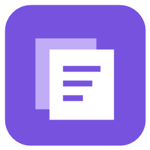

<p align="center">
  
</p>

<h1 align="center">Vstavka</h1>

<p align="center">
  <strong>Clipboard history in a panel at the bottom of your screen, for Windows, macOS and Ubuntu.</strong><br>
  Vstavka (Вставка) is Russian for “paste”.
</p>

<p align="center">
  <a href="https://apps.microsoft.com/detail/9NVXW230R4PX">Microsoft Store</a> ·
  <a href="#macos">macOS preview</a> ·
  <a href="#ubuntu">Ubuntu preview</a>
</p>

<p align="center">
  <a href="https://github.com/Xopoko/vstavka/actions/workflows/ci.yml"></a>
</p>

<picture>
  <source media="(prefers-color-scheme: dark)" srcset="docs/images/panel-dark.png">
  
</picture>

Vstavka remembers the text, links, color values, images and file paths you copy.
Press the shortcut, pick a card and press **Enter**: Vstavka returns focus to
the window you were in and pastes the item there. Each card shows the icon of
the app it came from.

Pin the items you use often, search the rest, and pause saving before you copy
something private. History stays on your computer and is encrypted. Vstavka has
no accounts, analytics or network features, and its interface is translated
into 24 languages.

## Get Vstavka

| | Windows 11 | macOS 13 or later | Ubuntu 24.04 or later |
| --- | --- | --- | --- |
| Install | [Microsoft Store](https://apps.microsoft.com/detail/9NVXW230R4PX) | [Build from source](#macos) | [Build from source](#ubuntu) |
| Status | Stable | Preview | Preview |
| Panel shortcut | Ctrl+Shift+V | ⇧⌘V | Ctrl+Alt+V |

The desktop app uses [Avalonia](https://avaloniaui.net/) on all three platforms.
The Avalonia package for Microsoft Store upgrades earlier Windows installs in
place. Windows builds also play optional clipboard sounds. There are no prebuilt
macOS or Ubuntu downloads yet. On Linux, Vstavka supports GNOME 46 to 51 on
Wayland, and X11 sessions.

## Using Vstavka

### First run

The cross-platform app opens a short guide: a welcome screen, the panel
shortcut (press a new combination to change it), the permissions your system
needs, and a step where you copy and paste something to check that everything
works.


- **Windows** asks before saving clipboard history on a new Store installation.
- **macOS** asks whether Vstavka may read the clipboard (recent macOS
  versions ask this of every app that does) and for **Accessibility**, which
  lets Vstavka press ⌘V for you. Without Accessibility, Vstavka copies the
  item and you paste it yourself.
- **Ubuntu** on Wayland needs the small GNOME Shell helper that comes with
  Vstavka. The guide installs and turns it on; GNOME loads it after you sign
  out and back in once. X11 sessions need nothing.


The Microsoft Store app asks you to choose a language and select **Enable
history**.

### Keys

| Action | Windows and Ubuntu | macOS |
| --- | --- | --- |
| Open or hide the panel | **Ctrl+Shift+V** on Windows, **Ctrl+Alt+V** on Ubuntu | **⇧⌘V** |
| Move from search to the cards, then between cards | **↓**, then **← / →** | **↓**, then **← / →** |
| Paste the selected card | **Enter** or double-click | **Enter** or double-click |
| Paste as plain text; file cards paste their paths | **Shift+Enter** | **Shift+Enter** |
| Paste the matching visible card | **Ctrl+1 … 9** | **⌘1 … 9** |
| Search | **Ctrl+F** | **⌘F** |
| Delete the selected card | **Delete** | **Delete** (⌫) |
| Hide the panel | **Esc** | **Esc** |

Right-click a card to paste it, paste it as plain text, copy, pin or delete
it. In the Store app you can also keep prompts and snippets in named, colored
collections, out of your everyday history: create one with **+** next to the
filters, and right-click it to rename it, change its color or delete it.
Deleting a collection also deletes the items in it.

Text is saved without formatting. File cards store paths, so the files must
still exist when you paste them. Windows does not let apps paste into programs
running as administrator; the item is still copied, so press Ctrl+V there
yourself.

### Settings

Settings hold the language, theme and accent color, the panel shortcut, start
at login, the permissions your system needs, how long to keep history and which
apps to ignore.

The cross-platform app takes any shortcut with Ctrl, Alt (Option) or ⌘ (Super);
the Store app offers Ctrl+Shift+V, Ctrl+Alt+V and Alt+V. Ubuntu defaults to
Ctrl+Alt+V because terminals paste with Ctrl+Shift+V. On Windows, while
Vstavka uses Ctrl+Shift+V, other apps stop receiving it, so their
paste-without-formatting command on that shortcut stops working.

<details>
<summary>Settings window on macOS</summary>
<br>

</details>

## Privacy

| | History and settings | Encryption |
| --- | --- | --- |
| Windows, Store app | `%LOCALAPPDATA%\Vstavka` | Windows Data Protection (DPAPI) for your account |
| Windows, cross-platform app | `%LOCALAPPDATA%\Vstavka.Preview` | Windows Data Protection (DPAPI) for your account |
| macOS | `~/Library/Application Support/Vstavka` | AES-256-GCM, key in your login Keychain |
| Ubuntu | `~/.local/share/vstavka` | AES-256-GCM, key in GNOME Keyring (Secret Service) |

- If the Keychain or GNOME Keyring is unavailable, the cross-platform app keeps
  history in memory until you quit and says so in Settings.
- Vstavka skips content while saving is paused, content copied from apps in the
  **Excluded apps** list (password managers by default), and content that apps
  mark as private: the Windows clipboard history flags, the
  [nspasteboard.org](http://nspasteboard.org/) markers on macOS and the KDE
  password hint on Linux.
- By default history keeps 500 items from the last 30 days. Pinned items and
  collection items stay until you remove them. **Clear history** in Settings
  deletes every item, including pinned items and collection contents.
- [Privacy policy](https://github.com/Xopoko/vstavka-support/blob/main/PRIVACY.md)

## Building from source

You need Git and the [.NET 10 SDK](https://dotnet.microsoft.com/download/dotnet/10.0),
version 10.0.400 or a later patch (see [global.json](global.json)). To try the
cross-platform app on any of the three systems:

```sh
git clone https://github.com/Xopoko/vstavka.git
cd vstavka
dotnet run --project src/Vstavka.Desktop
```

Add `-- --demo` to open it with sample items without reading your clipboard,
or `-- --demo --onboarding` to walk through the first-run guide.

### macOS

Build the app bundle on a Mac (use `osx-x64` on an Intel Mac):

```sh
dotnet publish src/Vstavka.Desktop -c Release -r osx-arm64 --self-contained -o artifacts/macos
scripts/package-macos-app.sh artifacts/macos artifacts
open artifacts/Vstavka.app
```

The bundle is signed ad hoc for local use, so macOS treats every rebuild as a
new app. After updating, turn Vstavka off and on again in **System Settings →
Privacy & Security → Accessibility**, and choose **Always Allow** when the
Keychain asks for the history key.

### Ubuntu

Publish the app to a folder you will keep (use `linux-arm64` on ARM) and start
it:

```sh
dotnet publish src/Vstavka.Desktop -c Release -r linux-x64 --self-contained -o ~/.local/opt/vstavka
~/.local/opt/vstavka/Vstavka.Desktop
```

On GNOME Wayland, the first-run guide sets up the GNOME Shell helper and allows
this executable to use it; sign out and back in when it asks. If you move the
folder later, allow the new location in Settings → Permissions. To set the
helper up by hand, see [gnome-extension/README.md](gnome-extension/README.md).

### Windows

The Microsoft Store app lives in `src/Vstavka`. With PowerShell 7 on Windows 11
x64:

```powershell
pwsh -File scripts/Build-Preview.ps1
pwsh -File scripts/Install-Preview.ps1
```

`Build-Preview.ps1` runs the test suites, publishes a self-contained `win-x64`
build to `artifacts/preview` and runs the app's self-test on it.
`Install-Preview.ps1` copies that build to `%LOCALAPPDATA%\Programs\Vstavka` and
adds a Start menu shortcut; exit Vstavka from its tray menu before updating.
`Uninstall-Preview.ps1` removes the local build and keeps your history.

To try the cross-platform app on Windows, exit the Store app first if both use
the same shortcut. The two apps keep separate histories.

### Tests

Each test suite is a console app, for example:

```sh
dotnet run --project tests/Vstavka.Core.Tests
```

CI runs the suites on Windows, macOS and Ubuntu, and checks the GNOME helper in
a headless GNOME Shell session. The tests use synthetic data and recorded
system boundaries; none of them reads your clipboard. See
[CONTRIBUTING.md](CONTRIBUTING.md) for the full list.

## Repository layout

| Path | Contents |
| --- | --- |
| `src/Vstavka.Core` | History, search, pins, collections, encrypted storage and the 24 language catalogs, shared by both apps |
| `src/Vstavka` | Original Windows app (WPF) |
| `src/Vstavka.Desktop` | Cross-platform app (Avalonia): panel, first-run guide, settings and tray icon |
| `src/Vstavka.Platform*` | Clipboard, shortcut, paste and window adapters for Windows, macOS and Linux |
| `gnome-extension` | GNOME Shell helper for Wayland |
| `tests` | Test suites, performance probes and the Store screenshot harness |
| `scripts` | Build, local install, MSIX and macOS app bundle scripts |
| `packaging` | MSIX manifest template and package assets, see [packaging/README.md](packaging/README.md) |
| `store` | Store listing text and screenshots |
| `docs` | [Cross-platform notes](docs/cross-platform.md), [localization notes](docs/localization.md) and the [manual acceptance checklist](docs/acceptance.md) |

## Support and contributing

Questions and bug reports go to
[vstavka-support](https://github.com/Xopoko/vstavka-support/issues/new/choose).
For code changes, see [CONTRIBUTING.md](CONTRIBUTING.md). Report security
issues privately as described in [SECURITY.md](SECURITY.md).

## License

The code is available under the [MIT License](LICENSE). The Vstavka name and
icon identify the official app; please give forks their own name and icon.
