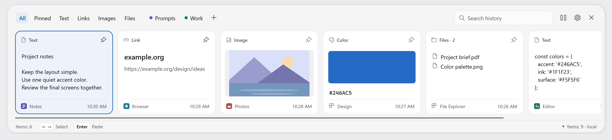

<p align="center">
  
</p>

<h1 align="center">Vstavka</h1>

<p align="center">
  <strong>Clipboard history for Windows 11, in a panel at the bottom of your screen.</strong><br>
  Vstavka (Вставка) is Russian for “paste”.
</p>

<p align="center">
  <a href="https://apps.microsoft.com/detail/9NVXW230R4PX">Get it from Microsoft Store</a>
</p>



Vstavka remembers the text, links, color values, images and file paths you copy.
Press **Ctrl+Shift+V**, pick a card, and press **Enter**: Vstavka returns focus to
the window you were in and pastes the item there. Each card shows the icon of
the app it came from.

Pin the items you use often, or keep prompts and snippets in named, colored
collections so they stay out of your everyday history. History is stored only
on your PC and encrypted for your Windows account. Vstavka has no accounts,
analytics or network features.

The Microsoft Store build can lag behind `main`.

## Using Vstavka

On first run, choose a language and select **Enable history**. Starting with
Windows is optional and can be changed later in Settings.

| Keys | Action |
| --- | --- |
| **Ctrl+Shift+V** | Open or hide the panel. **Ctrl+Alt+V** and **Alt+V** are available in Settings. |
| **↓**, then **← / →** | Move from search to the cards and select one |
| **Enter** or double-click | Paste the selected card |
| **Shift+Enter** | Paste as plain text; file cards paste their paths |
| **Ctrl+1 … 9** | Paste the matching visible card |
| **Ctrl+F** | Search |
| **Delete** | Delete the selected card |
| **Esc** | Hide the panel |

While Vstavka uses **Ctrl+Shift+V**, other apps do not receive that shortcut, so
their paste-without-formatting command on it stops working. Choose
**Ctrl+Alt+V** or **Alt+V** if you need it.

Right-click a card to paste, paste as plain text, copy, pin, add it to a
collection or delete it. Create a collection with **+** next to the filters;
right-click a collection to rename it, change its color or delete it. Deleting
a collection also deletes the items in it.

Text is saved without formatting. File cards store paths, so the files must
still exist when you paste them. Windows blocks automatic pasting into apps
running as administrator; copy the card and paste it there yourself.

## Privacy

- History and settings live in `%LOCALAPPDATA%\Vstavka` and are encrypted with
  Windows Data Protection for the current user. The Store build keeps its data
  separately from the local build.
- Vstavka skips content while saving is paused, content copied from apps in the
  **Excluded apps** list (password managers by default), and content that apps
  mark as private for clipboard history and clipboard monitors.
- By default history keeps 500 items from the last 30 days. Pinned items and
  collection items are kept until you remove them. **Clear history** in
  Settings deletes every item, including pinned items and collection contents.
- [Privacy policy](https://github.com/Xopoko/vstavka-support/blob/main/PRIVACY.md)

## Building from source

You need Windows 11 x64, PowerShell 7 and the .NET 10 SDK (10.0.400 or a later
patch, see [global.json](global.json)).

```powershell
pwsh -File scripts/Build-Preview.ps1
pwsh -File scripts/Install-Preview.ps1
```

`Build-Preview.ps1` runs the test suites, publishes a self-contained `win-x64`
build to `artifacts/preview` and runs the app's self-test on it.
`Install-Preview.ps1` copies that build to `%LOCALAPPDATA%\Programs\Vstavka` and
adds a Start menu shortcut; exit Vstavka from its tray menu before updating.
`Uninstall-Preview.ps1` removes the local build and keeps your history.

`Vstavka.exe` also accepts these development switches:

- `--demo` opens the panel with sample items and never reads the clipboard.
- `--test-session` opens a test pad and keeps a temporary history of copies
  made in that pad only.
- `--self-test --output <json>` runs the built-in UI and storage checks.
- `--render-preview --output <png>` renders the panel and settings with sample
  data in several themes and languages.

Run a test suite on its own with `dotnet run`:

```powershell
dotnet run --project tests/Vstavka.Core.Tests
```

The other suites are `Vstavka.Clipboard.Tests`, `Vstavka.Audio.Tests` and
`Vstavka.Localization.Tests`. They use synthetic data and recorded system
boundaries; none of them reads your clipboard.

## Repository layout

| Path | Contents |
| --- | --- |
| `src/Vstavka.Core` | History model, search, encrypted storage, collections and the 24 language catalogs |
| `src/Vstavka` | WPF app: panel, settings, clipboard and shortcut services, theme |
| `tests` | Test suites, performance probes and the Store screenshot harness |
| `scripts` | Build, local install and MSIX packaging scripts |
| `packaging` | MSIX manifest template and package assets, see [packaging/README.md](packaging/README.md) |
| `store` | Store listing text and screenshots |
| `docs` | [Localization notes](docs/localization.md) and the [manual acceptance checklist](docs/acceptance.md) |

## Support and contributing

Questions and bug reports go to
[vstavka-support](https://github.com/Xopoko/vstavka-support/issues/new/choose).
For code changes, see [CONTRIBUTING.md](CONTRIBUTING.md). Report security
issues privately as described in [SECURITY.md](SECURITY.md).

## License

The code is available under the [MIT License](LICENSE). The Vstavka name and
icon identify the official app; please give forks their own name and icon.
