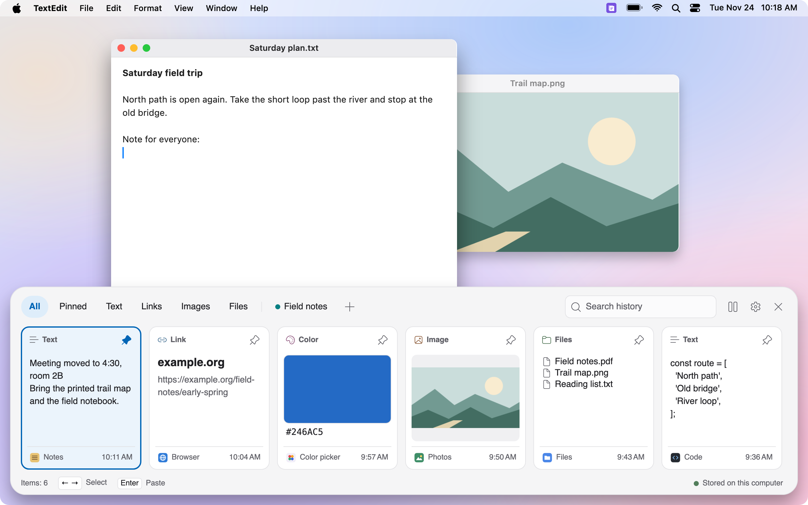
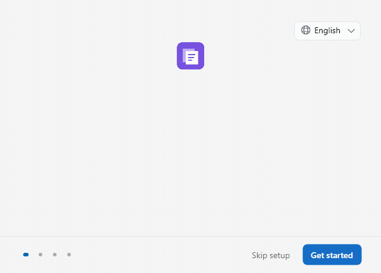
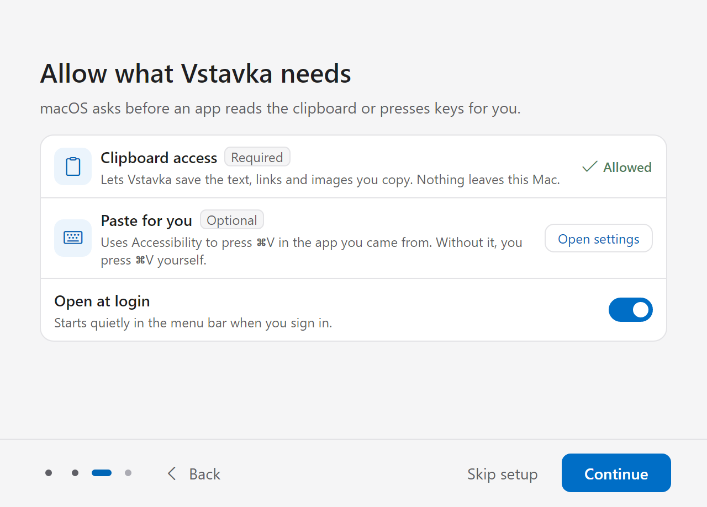
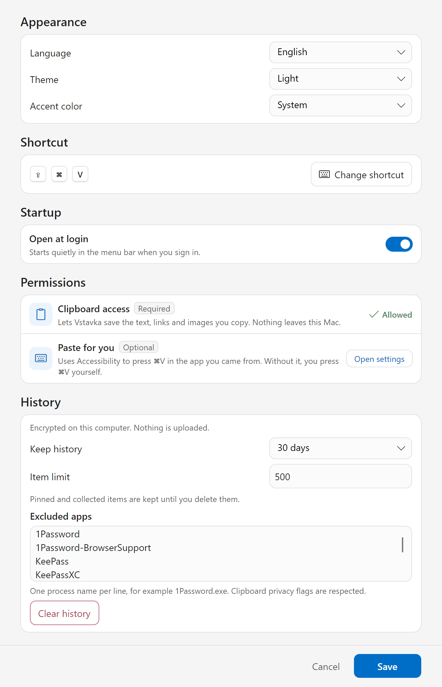

<p align="center">
  
</p>

<h1 align="center">Vstavka</h1>

<p align="center">
  <strong>Clipboard history in a panel at the bottom of your screen, for Windows, macOS and Ubuntu.</strong><br>
  Vstavka (Вставка) is Russian for “paste”.
</p>

<p align="center">
  <a href="https://apps.microsoft.com/detail/9NVXW230R4PX"><picture><source media="(prefers-color-scheme: dark)" srcset="https://get.microsoft.com/images/en-us%20light.svg"></picture></a>
  <a href="#macos"><picture><source media="(prefers-color-scheme: dark)" srcset="docs/images/badge-macos-light.svg"></picture></a>
  <a href="https://snapcraft.io/vstavka"><picture><source media="(prefers-color-scheme: dark)" srcset="docs/images/badge-ubuntu-light.svg"></picture></a>
</p>

<p align="center">
  <a href="https://github.com/Xopoko/vstavka/actions/workflows/ci.yml"></a>
</p>

<picture>
  <source media="(prefers-color-scheme: dark)" srcset="docs/images/desktop-dark.png">
  
</picture>

Vstavka remembers the text, links, color values, images and file paths you copy.
Press the shortcut, pick a card and press **Enter** to put it back on the
clipboard. When automatic paste is available, Vstavka also pastes it into your
previous window. Cards show the source app when available.

Pin the items you use often, search the rest, and pause saving before you copy
something private. Vstavka encrypts history when it saves it to disk. The app has
no accounts, analytics or cloud sync, and its interface is translated
into 24 languages.

## Get Vstavka

| | Windows 11 (x64) | macOS 13 or later (local build) | Ubuntu 24.04 or later |
| --- | --- | --- | --- |
| Install | [Microsoft Store](https://apps.microsoft.com/detail/9NVXW230R4PX) | [Build from source](#macos) | [Snap Store, x64](https://snapcraft.io/vstavka) · [Build from source](#ubuntu) |
| Status | Stable | Preview | Preview |
| Panel shortcut | Ctrl+Shift+V | ⇧⌘V | Ctrl+Alt+V by default on X11. Choose a shortcut on Snap with GNOME Wayland. |

The desktop app uses [Avalonia](https://avaloniaui.net/) on all three platforms.
Windows builds play optional clipboard sounds. Vstavka 1.0.0 from the Snap Store
requires X11. Version 1.1.0 adds [GNOME on Wayland](#snap-on-gnome-wayland).
The Ubuntu source build uses a bundled GNOME helper compatible with GNOME 46–51.

### Snap on GNOME Wayland

Vstavka 1.1.0 is available from the Snap Store's candidate channel while the
companion is in GNOME review. Install it with `sudo snap install vstavka --candidate`.

In Vstavka 1.1.0, open **GNOME Extensions** from the first-run guide or
**Settings → Permissions** and enable [Vstavka Clipboard for Snap](https://extensions.gnome.org/extension/11930/vstavka-clipboard-for-snap/).
Choose a shortcut in Vstavka. The companion supports GNOME 46 and 50, and the
Snap detects whether it is enabled.

## Using Vstavka

### First run

The first-run guide lets you choose a language, record the panel shortcut,
grant permissions and try a copy and paste.



- **Windows** asks you to select **Enable history** on a new Store installation.
- **macOS** may ask for permission to read the clipboard. The local app can
  also request **Accessibility** for automatic paste. With the App Store build
  or without Accessibility, paste the selected item yourself with **⌘V**.
- **Ubuntu** source builds on Wayland use the bundled GNOME Shell helper. The
  guide installs and turns it on. GNOME loads it after you sign out and back in
  once. X11 sessions need no helper.



### Keys

| Action | Windows and Ubuntu | macOS |
| --- | --- | --- |
| Open or hide the panel | **Ctrl+Shift+V** on Windows, **Ctrl+Alt+V** on Ubuntu | **⇧⌘V** |
| Move from search to the cards, then between cards | **↓**, then **← / →** | **↓**, then **← / →** |
| Use the selected card | **Enter** or double-click | **Enter** or double-click |
| Use as plain text, or copy the paths from a file card | **Shift+Enter** | **Shift+Enter** |
| Use a visible card by position | **Ctrl+1 … 9** | **⌘1 … 9** |
| Search | **Ctrl+F** | **⌘F** |
| Delete the selected card | **Delete** | **Delete** (⌫) |
| Hide the panel | **Esc** | **Esc** |

Right-click a card for copy, pin and delete options. Keep prompts and snippets
in named, colored collections outside your everyday history. Create one with
**+** next to the filters, and right-click it to rename it, change its color or
delete it.
Deleting a collection also deletes the items in it.

Text is saved without formatting. File cards store paths, so the files must
still exist when you paste them. If Windows blocks automatic paste into a
program running as administrator, press **Ctrl+V** there yourself.

### Settings

Settings hold the language, theme and accent color, the panel shortcut, start
at login, the permissions your system needs, how long to keep history and which
apps to ignore.

Record an available shortcut with Ctrl, Alt (Option on macOS), or the Windows,
Command or Super key. Ubuntu defaults to Ctrl+Alt+V because terminals paste
with Ctrl+Shift+V. On Windows, choose a different shortcut if you use
Ctrl+Shift+V to paste without formatting in other apps.

<details>
<summary>Settings window on macOS</summary>
<br>

</details>

## Privacy

| | History and settings | Encryption |
| --- | --- | --- |
| Windows, Store app | `%LOCALAPPDATA%\Vstavka` | Windows Data Protection (DPAPI) for your account |
| Windows, local build | `%LOCALAPPDATA%\Vstavka.Preview` | Windows Data Protection (DPAPI) for your account |
| macOS | `~/Library/Application Support/Vstavka` for the local build, or `Library/Application Support/Vstavka` in the App Store sandbox | AES-256-GCM, key in your login Keychain |
| Ubuntu, local build | `$XDG_DATA_HOME/vstavka` (defaults to `~/.local/share/vstavka`) | AES-256-GCM, key in GNOME Keyring (Secret Service) |
| Ubuntu, Snap | `~/snap/vstavka/common/.local/share/vstavka` | AES-256-GCM, key protected by your desktop’s Secret portal |

- If the system key store is unavailable, Vstavka keeps history in memory
  until you quit.
- Vstavka skips content while saving is paused, content copied from apps in the
  **Excluded apps** list (password managers by default), and content that apps
  mark as private: the Windows clipboard history flags, the
  [nspasteboard.org](http://nspasteboard.org/) markers on macOS and the KDE
  password hint on Linux.
- By default history keeps 500 items from the last 30 days. Pinned items and
  collection items stay until you remove them. **Clear history** in Settings
  deletes every item, including pinned items and collection contents.
- [Privacy policy](https://github.com/Xopoko/vstavka-support/blob/main/PRIVACY.md)

## Building from source

You need Git and the [.NET 10 SDK](https://dotnet.microsoft.com/download/dotnet/10.0),
version 10.0.400 or a later patch (see [global.json](global.json)). To try the
cross-platform app on any of the three systems:

```sh
git clone https://github.com/Xopoko/vstavka.git
cd vstavka
dotnet run --project src/Vstavka.Desktop
```

Add `-- --demo` to open it with sample items without reading your clipboard,
or `-- --demo --onboarding` to walk through the first-run guide.

### macOS

Build the app bundle on a Mac (use `osx-x64` on an Intel Mac):

```sh
dotnet publish src/Vstavka.Desktop -c Release -r osx-arm64 --self-contained -o artifacts/macos
scripts/package-macos-app.sh artifacts/macos artifacts
open artifacts/Vstavka.app
```

The bundle is signed ad hoc for local use, so macOS treats every rebuild as a
new app. After updating, turn Vstavka off and on again in **System Settings →
Privacy & Security → Accessibility**, and choose **Always Allow** when the
Keychain asks for the history key.

### Ubuntu

Publish the app to a folder you will keep (use `linux-arm64` on ARM) and start
it:

```sh
dotnet publish src/Vstavka.Desktop -c Release -r linux-x64 --self-contained -o ~/.local/opt/vstavka
~/.local/opt/vstavka/Vstavka.Desktop
```

On GNOME Wayland, the first-run guide sets up the GNOME Shell helper and allows
this executable to use it; sign out and back in when it asks. If you move the
folder later, allow the new location in Settings → Permissions. To set the
helper up by hand, see [gnome-extension/README.md](gnome-extension/README.md).

### Windows

To run a local build on Windows 11 x64:

```powershell
dotnet publish src/Vstavka.Desktop -c Release -r win-x64 --self-contained -o artifacts/windows-preview
& ./artifacts/windows-preview/Vstavka.Desktop.exe
```

Exit the Store app first if it uses the same shortcut. The local build has a
separate history. See the [MSIX instructions](packaging/README.md) to build for
Microsoft Store.

### Tests

Each test suite is a console app, for example:

```sh
dotnet run --project tests/Vstavka.Core.Tests
```

CI runs the suites on Windows, macOS and Ubuntu, and checks the GNOME helper in
a headless GNOME Shell session. The tests use synthetic data and recorded
system boundaries; none of them reads your clipboard. See
[CONTRIBUTING.md](CONTRIBUTING.md) for the full list.

## Repository layout

| Path | Contents |
| --- | --- |
| `src/Vstavka.Core` | History, search, pins, collections, encrypted storage and language catalogs |
| `src/Vstavka.Desktop` | Avalonia panel, first-run guide, settings and tray icon |
| `src/Vstavka.Platform*` | Clipboard, shortcut, paste and window adapters for Windows, macOS and Linux |
| `gnome-extension` | GNOME Shell helper for Wayland |
| `tests` | Test suites and performance probes |
| `scripts` | MSIX and macOS app bundle scripts |
| `packaging` | MSIX manifest template and package assets, see [packaging/README.md](packaging/README.md) |
| `store` | Store listing text, Microsoft Store and Mac screenshots, and archived Windows WPF screenshots |
| `docs` | [Cross-platform notes](docs/cross-platform.md), [localization notes](docs/localization.md) and the [manual acceptance checklist](docs/acceptance.md) |

## Support and contributing

Questions and bug reports go to
[vstavka-support](https://github.com/Xopoko/vstavka-support/issues/new/choose).
For code changes, see [CONTRIBUTING.md](CONTRIBUTING.md). Report security
issues privately as described in [SECURITY.md](SECURITY.md).

## License

The code is available under the [MIT License](LICENSE). The Vstavka name and
icon identify the official app; please give forks their own name and icon.
